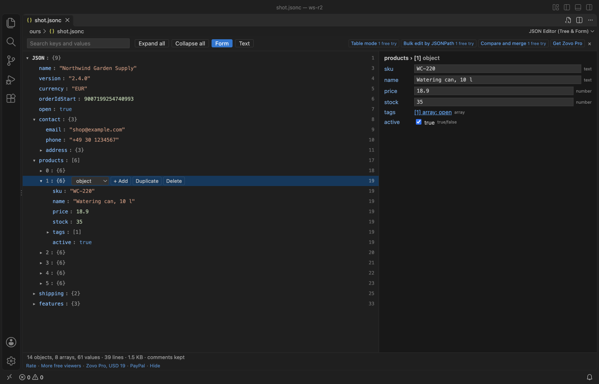

# JSON Editor, Tree & Form View

JSON editor for VS Code, by Zovo. Open a `.json` or `.jsonc` file in a tree with a form beside it, change keys, values and types with a few clicks, and save a file that still has its comments and its formatting. It uses your color theme, dark or light.

Free, offline, no account. Zovo Pro: USD 19 once, for this and every other Zovo extension. It adds Table mode, Bulk edit by JSONPath, and Compare and merge, with 1 free try of each. Everything free stays free.

*A real VS Code window in the Dark Modern theme, running this extension on [`samples/shop-catalog.jsonc`](samples/shop-catalog.jsonc), the sample that ships with it.*

## Free

- Open any `.json`, `.jsonc` or `.json5` file in the tree: right-click it and pick "Edit in JSON Editor (Tree & Form)", or click the pencil button at the top right of a JSON text tab. The text editor stays the default for JSON files.
- Expand and collapse objects and arrays one by one or all at once. Long arrays show 200 entries at a time, with a "Show more" link.
- Double-click a value or a key to change it. Text stays text. In a number, true/false or null value, anything that is not a number, true, false or null is stored as text.
- Add, duplicate and delete entries with the buttons on the selected row, drag a row to another place in its object or array, and pick a new type from the type menu (text, number, true/false, null, object, array). A type change keeps what it can: `"12"` becomes `12`, `1` becomes `"1"`.
- The form beside the tree shows the fields of the selected object or array: text and number boxes, a checkbox for true/false, and a link into each nested object or array. The Form button hides it.
- Keyboard: arrow keys to move, open and close, Enter to edit, F2 to rename, Delete to delete, Ctrl+D (Cmd+D) to duplicate, Ctrl+Z (Cmd+Z) to undo.
- Search keys and values. The tree then shows the matches and the objects and arrays they sit in.
- Click the line number at the end of a row to see that value selected in the text editor beside the tree.
- Big numbers stay exact. Numbers are shown and saved as written, so an id such as `9007199254740993` keeps its last digit.
- Comments and trailing commas are fine, as in VS Code's own `settings.json` and `tsconfig.json`.
- A file with a syntax error opens read-only, with the line and column of each error and a button that opens the text.

## Quick start

1. Install JSON Editor, Tree & Form View.
2. Right-click a `.json` file in the Explorer and pick "Edit in JSON Editor (Tree & Form)". No file at hand? Run "JSON Editor: Open the Sample File" from the Command Palette.
3. Double-click a value, type, press Enter, then save with `Ctrl+S` (`Cmd+S` on macOS).

## How a save keeps your file

The tree is a view of the text file, not a copy of it. A change in the tree or the form replaces only the text of the value or key you changed, and every other byte stays: comments, key order, spacing and line endings. A new or moved entry follows its neighbours: on one line if they are on one line, one per line with the same indent (spaces or tabs) if not, and with the file's line endings.

Undo, redo, save and the unsaved dot are VS Code's own and work across the tree and the text editor. Type in the text editor and the tree follows after a short pause. A file you only open is never written.

We checked this on real files from the VS Code repository (its `settings.json` with 20 comment lines, a language configuration file with comments, a `tsconfig.json` and the 139 KB `package.json` of the Git extension) and on JSONTestSuite cases: writing values back unchanged gives the same bytes, and renaming a key keeps every comment line.

## Zovo Pro tools (1 free try each)

- Table mode: open an array of objects as a table, one row per item and one column per key. Click a column header to sort, type to filter the rows, and double-click a cell to edit it (a missing key is added to that row). Add a column to every row that lacks it (the value is `null`), and export the rows shown, in the order shown, to a CSV file. Nested objects and arrays show as `{n}` and `[n]` and are edited in the tree.
- Bulk edit by JSONPath: select values with a JSONPath query such as `$..price`, `$.items[*].name`, `$.items[?(@.stock == 0)]`, `$.items[0:5]` or the jq style `.items[].id`. Then set the value, rename the key, delete, change text to upper or lower case, trim it, or convert text to numbers and back. A preview lists every change before the file changes, and one undo takes it all back.
- Compare and merge: compare this file with another JSON file by key path. Key order does not matter, arrays are compared by position, and big numbers compare exactly. A Markdown report lists every changed, added and removed value; then tick the changes to copy from the other file into this one.

## Limits

- JSON5 syntax other than comments and trailing commas (keys without quotes, single quotes, hex numbers) opens read-only, with the line of the first such spot.
- Files up to 50 MB. The tree shows up to 20,000 rows at a time; open fewer objects or use the search for more.
- A key that appears twice in one object is shown and marked; the first one is read-only and edits go to the last one, which JSON readers use.
- Text values longer than 4,000 characters are edited in the text editor.
- A row can be dragged within its own object or array, not into another one.

## Privacy

The extension makes no network requests and sends no telemetry. Your files stay on your computer.

## More from Zovo

- [Large JSON Viewer](https://marketplace.visualstudio.com/items?itemName=zovo.zovo-json-tree-viewer): a fast read-only tree for very large JSON files.
- [JSONL Viewer](https://marketplace.visualstudio.com/items?itemName=zovo.zovo-jsonl-viewer): JSON Lines and NDJSON files as a table.

Made by Zovo. MIT license. The JSON parser is jsonc-parser by Microsoft (MIT); see THIRD-PARTY-NOTICES.md.
